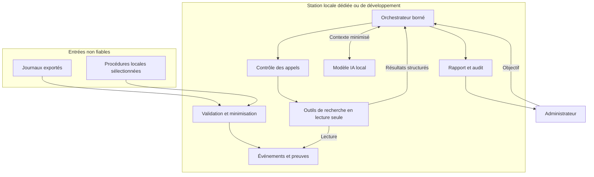

# NetWatch Sentinel

**Un agent IA local pour aider les petites équipes IT à comprendre leurs alertes et préparer un diagnostic vérifiable.**

Projet de William, en formation Technicien supérieur systèmes et réseaux (TSSR). Dossier de conception préparé pour l’**ASUS Agent Computer Challenge — catégorie AI Entry**.

> **Statut au 18 novembre 2026 : conception, version documentaire 0.1.**
> Ce dépôt contient une proposition d’architecture et des spécifications à discuter. Aucun agent, collecteur, modèle configuré, mécanisme de sécurité ou résultat de benchmark n’est implémenté. Les exemples sont fictifs. Les choix techniques restent soumis à validation.

## Le problème

Dans une petite structure, un administrateur doit souvent rapprocher des événements Windows, des journaux Linux et des alertes réseau, puis retrouver la bonne procédure. Les informations sont dispersées ; une alerte isolée ne suffit pas toujours à expliquer ce qui s’est passé.

NetWatch Sentinel vise à transformer un dossier d’événements en une chronologie compréhensible, des hypothèses étayées et une liste de vérifications. Les journaux et documents seraient traités localement. L’administrateur garderait la décision sur les suites à donner.

## Le fonctionnement envisagé

1. Recevoir un objectif borné, par exemple : « examiner cette série d’échecs de connexion ».
2. Contrôler et normaliser les événements fournis.
3. Choisir des recherches utiles parmi des outils autorisés en lecture seule.
4. Rapprocher les preuves et, si disponible, une procédure locale référencée.
5. Produire un rapport qui sépare faits, hypothèses, limites et recommandations.
6. Soumettre le rapport à l’administrateur, qui peut le corriger, le rejeter ou le valider.

Le caractère agentique vient du choix borné des recherches et de leur réévaluation en fonction des résultats. Le modèle ne reçoit pas de terminal libre et ne détermine pas ses propres permissions.

## Premier périmètre proposé

| Élément | Proposition pour le premier prototype | État |
| --- | --- | --- |
| Cas d’usage | Examiner des authentifications Linux exportées | À valider : D-001 |
| Entrées | Petit lot de journaux synthétiques ou anonymisés, importé manuellement | À valider |
| Sortie | Rapport local sourcé et trace des outils utilisés | À valider |
| Autonomie | Recherches bornées sur les données importées | À valider |
| Réponse aux incidents | Recommandations ; interventions effectuées par l’humain hors de l’agent | À valider |
| Évolutions | Sources Windows Server, Linux et pare-feu ; collecte autorisée | Hors du premier prototype |

La surveillance continue constitue la vision à terme. Le premier prototype proposé analyse un lot d’événements : il ne surveille encore aucun système en temps réel.

## Architecture logique proposée

Les composants sont des responsabilités logiques ; ils ne supposent pas des microservices ni plusieurs agents indépendants. Voir [l’architecture technique](architecture/TECHNICAL_DESIGN.md) et [les flux de données](architecture/DATA_FLOW.md).

## Sécurité prévue

Les contrôles décrits sont des **exigences de conception à implémenter et tester** : séparation entre instructions et données, permissions minimales, outils autorisés avec arguments validés, absence de commande arbitraire, traitement local sans repli cloud, sortie maîtrisée des données et traçabilité. Un journal ou un document peut contenir une instruction malveillante ; son texte ne doit jamais accorder de nouveaux droits.

Les garde-fous applicatifs et système doivent limiter l’impact d’une erreur du modèle. Un prompt ou un système de RAG ne garantit pas, à lui seul, cette sécurité. Voir [le modèle de menaces](docs/THREAT_MODEL.md) et [les exigences de sécurité](docs/SECURITY_DESIGN.md).

## Matériel et faisabilité

La RTX 5080 16 Go déjà disponible servirait aux premières expérimentations. Une éventuelle RTX 5060 Ti 16 Go permettrait d’envisager une seconde machine dédiée, distincte du poste personnel. La disponibilité et la séparation des usages motivent cette évolution. Une carte seule ne constitue ni une machine complète, ni une garantie d’isolation.

Le modèle, sa quantification, sa fenêtre de contexte et les ressources du reste de la machine seront choisis après mesures. Aucune performance ni économie d’énergie n’est revendiquée. Voir [l’étude matérielle](docs/HARDWARE.md).

## Parcours de lecture

| Besoin | Document |
| --- | --- |
| Comprendre le produit et ses limites | [Vision et périmètre](docs/VISION_AND_SCOPE.md) |
| Vérifier les exigences | [Exigences et critères d’acceptation](docs/REQUIREMENTS.md) |
| Examiner les composants et les options | [Architecture technique](architecture/TECHNICAL_DESIGN.md) |
| Suivre les traitements et frontières de confiance | [Flux de données](architecture/DATA_FLOW.md) |
| Comprendre les boucles agentiques | [Workflows](docs/AGENT_WORKFLOWS.md) |
| Examiner les permissions des outils | [Contrats des outils](docs/TOOL_CONTRACTS.md) |
| Examiner les risques et protections | [Menaces](docs/THREAT_MODEL.md) · [Sécurité](docs/SECURITY_DESIGN.md) |
| Lire un exemple concret | [Scénario fictif](examples/incident-review/SCENARIO.md) · [Rapport fictif](examples/incident-review/EXPECTED_REPORT.md) |
| Comprendre les données et la base documentaire | [Données et RAG](docs/DATA_AND_RAG.md) |
| Préparer les validations | [Plan d’évaluation](docs/EVALUATION_PLAN.md) |
| Examiner les décisions encore ouvertes | [Registre des décisions](docs/DECISIONS.md) |
| Suivre le projet | [Feuille de route](ROADMAP.md) · [Historique](CHANGELOG.md) |
| Préparer la candidature | [Dossier AI Entry](docs/CHALLENGE_AI_ENTRY.md) |
| Préparer GitHub | [Publication](docs/GITHUB_PUBLICATION.md) · [Contribution](CONTRIBUTING.md) |
| Vérifier les références | [Sources et provenance](docs/REFERENCES.md) |

## Utiliser ce dépôt

Il n’y a pas d’installation applicative à effectuer. Ouvrir les fichiers Markdown dans GitHub ou un éditeur ; GitHub peut rendre les diagrammes Mermaid. Ne pas chercher de service à lancer ni de dépendances à installer : ils seront ajoutés après validation des choix.

La branche initiale s’appelle `main`. Le choix d’un compte GitHub, de la visibilité et d’une licence reste ouvert. Ce dossier n’est pas encore un dépôt publié sur GitHub.

## Démarche

Nous avançons par décisions explicites : périmètre, limites d’autonomie, environnement, stockage, modèle, interface, puis implémentation. Une proposition écrite n’est pas une décision acceptée. Le [registre](docs/DECISIONS.md) conserve les raisons, les alternatives et la preuve de validation.

Projet personnel indépendant, sans affiliation ni approbation revendiquée d’ASUS ou d’un éditeur cité. Les noms de produits désignent les technologies étudiées. Aucune licence de réutilisation n’a encore été choisie ; voir [la préparation de publication](docs/GITHUB_PUBLICATION.md).
