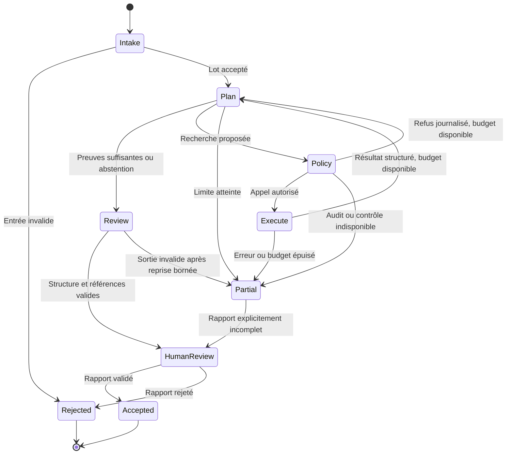

# Workflows agentiques proposés

Spécification de conception. Il n’existe pas encore de boucle agentique exécutée par NetWatch Sentinel.

## Un orchestrateur, plusieurs responsabilités

Les rôles de préparation, analyse, recherche documentaire et rédaction peuvent être réalisés séquentiellement par le même orchestrateur et le même modèle. Aucun besoin de plusieurs modèles simultanés ni d’agents se déléguant librement des droits n’est établi.

Le modèle propose une prochaine recherche en fonction des observations. L’application conserve l’état, valide les appels, borne les répétitions et décide si les conditions d’arrêt sont atteintes. Une corrélation fixe seule ne suffit pas à démontrer cette boucle adaptative.

## Machine à états cible

L’annulation peut terminer chaque état avec un résultat marqué annulé. La reprise d’une erreur consomme le budget ; elle ne réinitialise ni le nombre d’appels, ni le temps imparti.

## WF-01 — Examiner une séquence d’authentifications

**Déclencheur** : demande explicite de l’opérateur portant sur un lot et une fenêtre temporelle autorisés.

1. Vérifier le lot, sa provenance, les temps et les informations manquantes.
2. Regrouper les événements selon une règle explicable ; ses seuils seront validés séparément.
3. Le modèle peut demander `query_events` pour examiner la séquence, puis `summarize_auth_window` pour comparer les résultats.
4. Si un succès suit des échecs, rechercher les événements disponibles autour du même compte et de la même origine. Si aucun succès n’apparaît, approfondir seulement si les preuves et le budget le justifient.
5. Consulter éventuellement la procédure locale via `search_runbooks` et `read_runbook_section`.
6. Produire chronologie, constats, hypothèses alternatives, lacunes et recommandations.
7. Contrôler les références et soumettre à l’administrateur.

**Branchement utile** : succès présent → examiner la continuité ; uniquement des échecs → évaluer la répétition et les limites de visibilité ; aucun événement pertinent → rendre un constat de données insuffisantes. L’agent ne déclare jamais un succès d’authentification « malveillant » sans preuve complémentaire.

**Arrêts** : objectif couvert, preuves insuffisantes, appel interdit, budget épuisé, erreur de validation ou annulation.

## WF-02 — Préparer un diagnostic système

**Extension après le premier périmètre**, à valider dans D-012. Exemple : examiner l’indisponibilité d’un service à partir de ses journaux et d’un état collecté.

L’agent comparerait les preuves disponibles, demanderait un état de service ou une mesure autorisée via un outil spécialisé, puis expliquerait les causes possibles. Aucun redémarrage, changement de configuration ou installation ne serait exposé comme outil dans cette extension de diagnostic.

Avant des accès vivants : définir l’actif, le compte de lecture, les flux, la fraîcheur des mesures, la limite de débit et l’effet des lectures sur la machine. Une commande qui affiche un résultat peut tout de même avoir des effets ; chaque outil doit être examiné, pas simplement qualifié de « diagnostic ».

## WF-03 — Retrouver une procédure locale

**Option pour la tranche documentaire** : sélectionner un corpus explicite ; filtrer les documents accessibles avant recherche ; renvoyer des passages avec identifiant, version et section ; rédiger une recommandation liée à ces passages. Si aucune source ne correspond, l’agent le dit et n’invente pas une procédure interne.

Une procédure n’est ni un ordre d’exécution ni une autorisation. Les instructions contenues dans le texte restent des données, y compris « ignore les règles » ou une demande de transmission externe.

## Validation humaine

L’opérateur voit les preuves, la couverture, les appels autorisés et refusés et les incertitudes. Il peut valider, rejeter ou annoter le **rapport**. Cette validation n’exécute aucune mesure corrective. Toute future fonction d’action nécessiterait une décision, un périmètre et des contrôles supplémentaires ; elle n’est pas incluse dans ces workflows.

## Trace proposée

Pour chaque étape : identifiant d’exécution, état, horodatage, outil, arguments minimisés, décision de politique, résultat référencé, durée et état du budget. Enregistrer une justification opérationnelle courte et les preuves utiles, sans demander ni conserver une chaîne de raisonnement interne détaillée du modèle.
